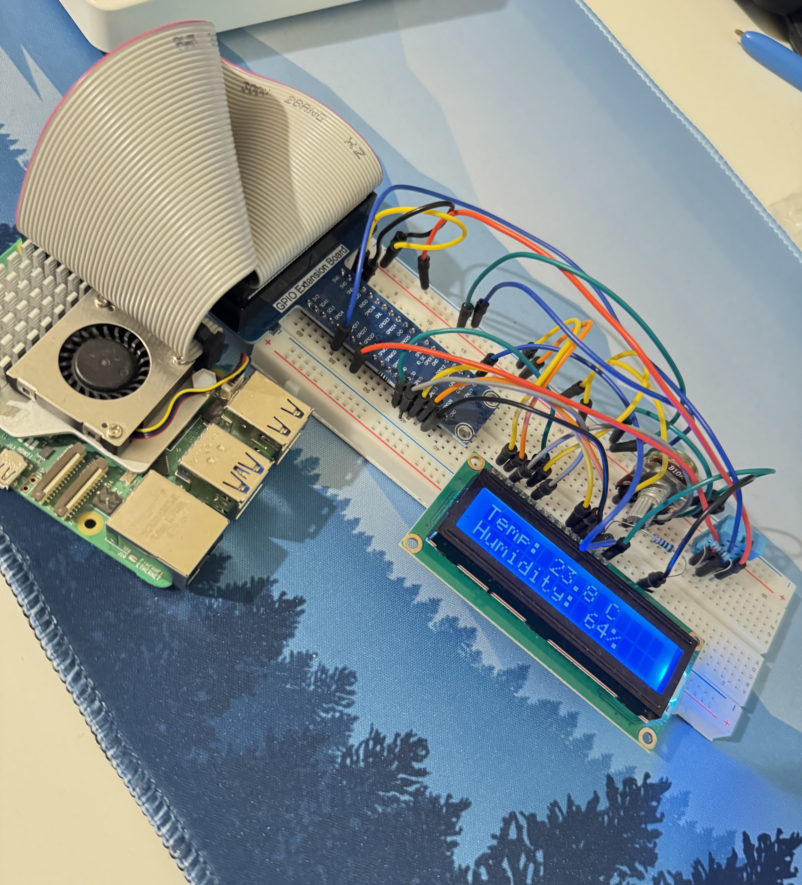

# Raspberry Pi Environmental Monitor



A small Raspberry Pi project that measures **temperature and humidity** using a DHT11 sensor and displays the readings on a **16×2 LCD**.

This project was built as a hands-on introduction to electronics, GPIO, sensors, breadboards, and interfacing physical hardware with Python.

## Features

- 🌡️ Temperature measurement
- 💧 Humidity measurement
- 📟 Live readings on a 16×2 LCD
- 🐍 Python-based implementation
- 🔌 Raspberry Pi GPIO interfacing

## Hardware

- Raspberry Pi 5
- DHT11 temperature/humidity sensor
- 16×2 HD44780-compatible LCD
- 10kΩ potentiometer
- 220Ω resistor
- Solderless breadboard
- GPIO breakout/extension board
- Jumper wires

## GPIO Connections

### DHT11

| DHT11 | Raspberry Pi |
|---|---|
| VCC | 3.3V |
| DATA | GPIO17 |
| GND | GND |

A pull-up resistor is connected between VCC and DATA.

### LCD

| LCD Pin | Function | Raspberry Pi |
|---|---|---|
| RS | Register Select | GPIO5 |
| E | Enable | GPIO6 |
| D4 | Data 4 | GPIO13 |
| D5 | Data 5 | GPIO19 |
| D6 | Data 6 | GPIO26 |
| D7 | Data 7 | GPIO21 |

The LCD's **RW pin is connected to GND**.

The LCD is powered from **5V**, with the contrast controlled using the 10kΩ potentiometer. The backlight is powered through a 220Ω resistor.

## Software Setup

Clone the repository and enter the project directory:

```bash
git clone <repository-url>
cd environment-monitor
```

Create and activate a virtual environment:

```bash
python3 -m venv .venv
source .venv/bin/activate
```

Install the required packages:

```bash
pip install -r requirements.txt
```

## Running

Run the monitor with:

```bash
python src/monitor.py
```

The current temperature and humidity readings will be displayed on the LCD and printed to the terminal.

## How It Works

The DHT11 provides temperature and humidity data through a digital data line connected to GPIO17.

The Raspberry Pi reads the sensor using the Adafruit CircuitPython library and sends the resulting values to the LCD using a 4-bit parallel interface.

The LCD uses GPIO5, GPIO6, GPIO13, GPIO19, GPIO26 and GPIO21 for control and data.

## Troubleshooting

One useful lesson from this build was discovering that the breadboard's power rails were **split into electrically separate sections**. The Raspberry Pi was supplying power to one section while components on the other section were not receiving it.

Bridging the corresponding power rails resolved the issue.

This was a useful reminder that successful software execution does not necessarily mean the underlying hardware is correctly powered or connected.

## Future Improvements

Possible extensions include:

- Ambient light sensing
- Additional environmental sensors
- Data logging
- Web-based monitoring
- Remote access
- Integration with a larger robotics or IoT system

## Project Status

**Completed — Version 1.0**